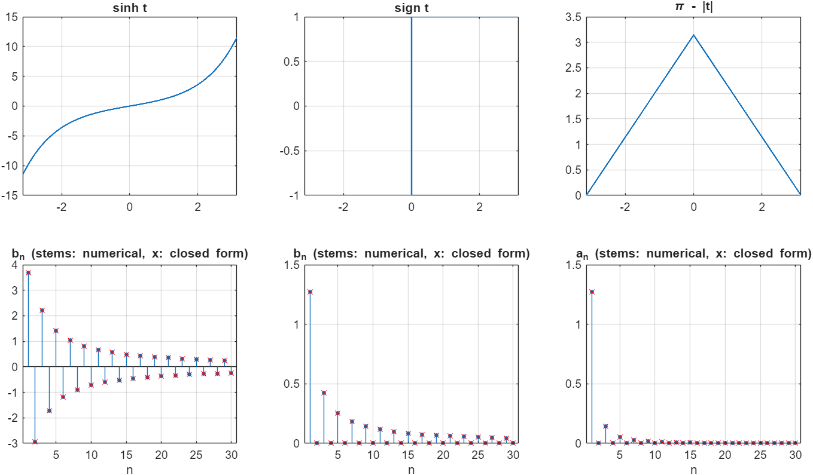
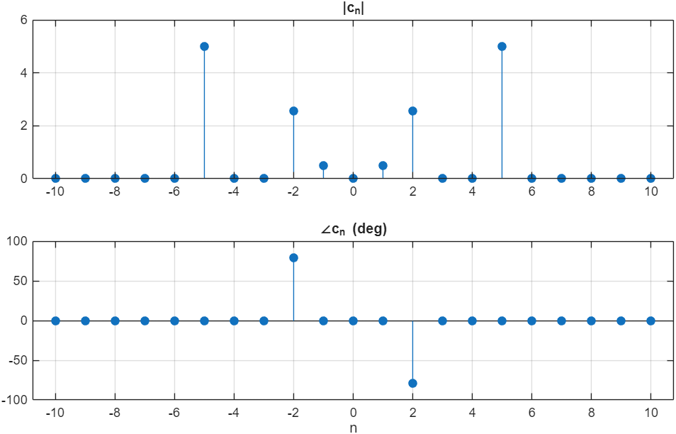
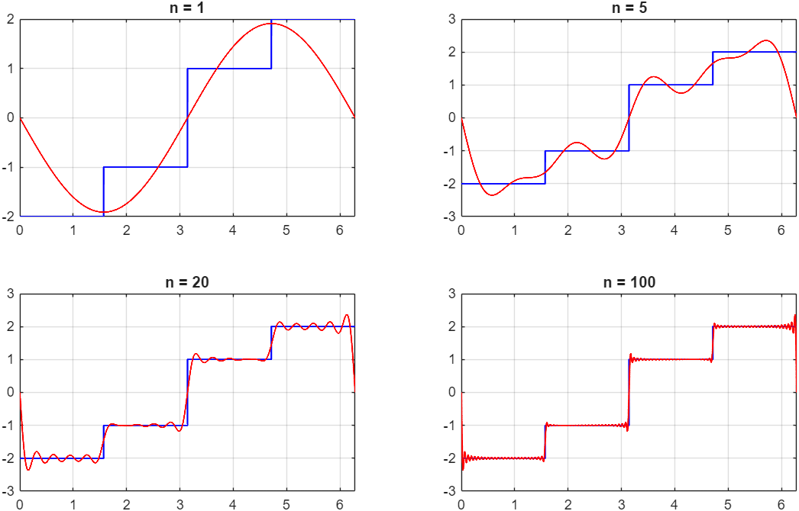
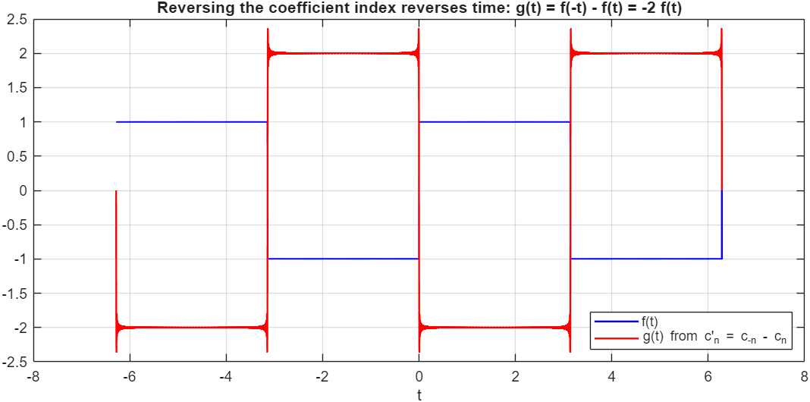
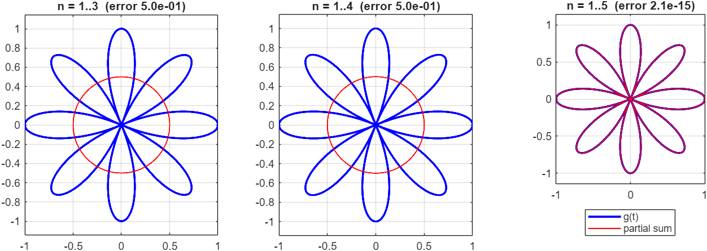

# Engineering Mathematics, TA Solutions for MATLAB Homework 1: Fourier Series

> **Context:** These are reference solutions I wrote as a **teaching assistant** for Engineering Mathematics at Amirkabir University of Technology. This repo is a cleaned-up and verified version of them.
>
> Run `main` in base MATLAB. Figures go to `results/`.

Every coefficient is computed numerically with `trapz`, then **checked against its closed form**:

| Q | Task | Closed form | Max error |
|---|---|---|---:|
| 1 | Trigonometric series of sinh t, sign t and π − \|t\| on (−π, π) | b_n = 2(−1)^{n+1} n sinh π / (π(n²+1)); b_n = 4/(nπ) for odd n; a₀ = π/2, a_n = 4/(πn²) for odd n | 2 × 10⁻⁶ |
| 2 | Complex coefficients of cos 2πt + 5 sin 4πt + cos 4πt + 10 cos 10πt | c_{±1} = ½, c_{±2} = ½ ∓ 2.5j, c_{±5} = 5 | 10⁻¹⁵ |
| 3a | Partial sums of a −2/−1/1/2 staircase | Gibbs overshoot at the jump: 8.9 % measured, 8.9 % in theory | – |
| 3b | Series of the complex curve g(t) = cos 4t · e^{jt} | g = (e^{j5t} + e^{−j3t})/2, so only harmonics 3 and 5 appear and the sum is **exact at n = 5** | 2 × 10⁻¹⁵ |
| 4 | Resynthesise a square wave from c′ₙ = c₋ₙ − cₙ | g(t) = f(−t) − f(t) = −2f(t), because the square wave is odd | rms 0.005 |

**Q1 lesson: smoothness sets the decay rate.**
- sinh t and sign t have a jump in their periodic extension, so their coefficients fall off as 1/n.
- The triangle is continuous, so its coefficients fall off as 1/n².

| Q1 | Q2 |
|---|---|
|  |  |

| Q3a | Q4 |
|---|---|
|  |  |

**Q3b.** The partial sums up to n = 3 and n = 4 contain only the e^{−j3t}/2 term, which traces a circle of radius ½. Adding n = 5 brings in the e^{j5t}/2 term and completes the eight-petal rose exactly.

## Changes compared with the original solutions
- **Closed-form checks.** The original only plotted the coefficients. Every result is now compared with its analytic value, and the remarks about decay rate and the Gibbs effect are added.
- **Grid resolution.** The original used 1000 samples per period, but Q4 computed harmonics up to n = 500. That is the Nyquist limit of the grid, so the high-order coefficients were unreliable. The grid now has 20 001 points.
- **Signal definitions.** The signals were built by concatenating index halves, for example `[-ones(1,500) ones(1,500)]`. They are now written as explicit functions of t, such as `sign(t)` and `pi - abs(t)`.
- **Q3b explanation.** The original looked like it was fitting a trigonometric series to a complex function. That is valid, because the formulas apply to complex functions too, and the README now explains why five terms reconstruct the curve exactly.
- **Script structure.** The `pause`-driven animations became snapshot figures. The separate `clear; close all` sections were merged into one script that runs headlessly.

**Sepehr Ebrahimi**, B.Sc. Electrical Engineering, Amirkabir University of Technology (2026)
